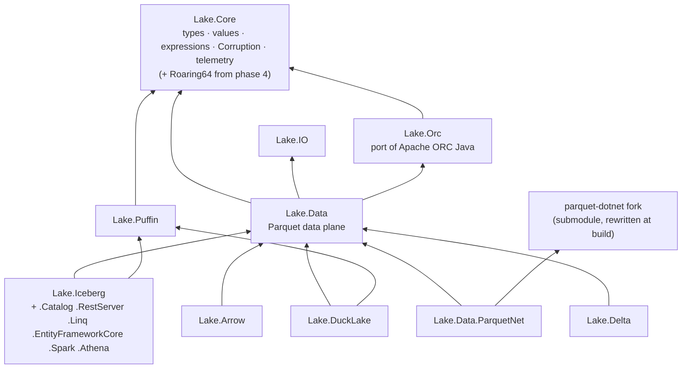

# Packages: names and dependencies

**Status:** target state. Covers every project's name in each phase, who publishes which package, and the
dependency graph Lake.NET should end up with. The phases are listed in the [overview](README.md#phases).

## Project mapping

The test that decides phase 1 is whether a project references `Iceberg.Net.Core`. Only `IO` (AWSSDK.S3 only) and
`Puffin` (ZstdSharp only) don't, so only those two get neutral names straight away.

| Today | Phase 1: mechanical rename | Phase 3: after extraction |
|---|---|---|
| `Iceberg.Net.IO` | `Lake.IO` | `Lake.IO` |
| `Iceberg.Net.Puffin` | `Lake.Puffin` (Format/ and Blobs/ unchanged) | `Lake.Puffin` (container and blob types). Roaring64 stays here until phase 4, then moves to `Lake.Core` once Delta has verified the byte layout |
| `Iceberg.Net.Core` | `Lake.Iceberg.Core` | Split: types, physical values, expressions, `Corruption` and telemetry helpers → `Lake.Core`. Metadata, transforms, partition specs, JSON and the manifest model stay in Iceberg |
| `Iceberg.Net.Avro` | `Lake.Iceberg.Avro` | Merged into Iceberg ([D4](decisions.md#d4)); a generic `Lake.Avro` only if another format needs Avro |
| `Iceberg.Net.Catalog` | `Lake.Iceberg.Catalog` | `Lake.Iceberg.Catalog` |
| `Iceberg.Net.Data` | `Lake.Iceberg.Data` | Split: `ParquetFiles`, `NestedColumns`, `ParquetModel`/`IParquetBackend`, `ParquetSharpBackend` and `ParquetInspection` → `Lake.Data`. Scans, snapshot producers, mutations and maintenance stay in Iceberg |
| `Iceberg.Net.Data.ParquetNet` | `Lake.Data.ParquetNet` (not packed) | Packed with the fork built in, its identity rewritten at build ([D10](decisions.md#d10)) |
| `Iceberg.Net.Arrow` | `Lake.Iceberg.Arrow` | `Lake.Arrow` over `Lake.Data` rows ([D2](decisions.md#d2)) |
| `Iceberg.Net.Linq` | `Lake.Iceberg.Linq` | Stays as it is until a second format needs it ([typed access](shared-layers.md#typed-access)) |
| `Iceberg.Net.EntityFrameworkCore` | `Lake.Iceberg.EntityFrameworkCore` | Same as LINQ |
| `Iceberg.Net.RestServer` | `Lake.Iceberg.RestServer` | Unchanged; the REST catalog is Iceberg's protocol |
| `Iceberg.Net.Spark` | `Lake.Iceberg.Spark` | Unchanged; Delta procedures, if added, get their own package |
| `Iceberg.Net.Athena` | `Lake.Iceberg.Athena` | Unchanged |
| `Iceberg.Net.DuckLake` (branch) | `Lake.DuckLake` (not packed) | References only `Lake.Core`, `Lake.IO`, `Lake.Data` and `Lake.Puffin` |
| — | — | `Lake.Delta` (new, [phase 4](delta.md)) |
| — | — | `Lake.Orc` (new, a port of Apache ORC Java, [D8](decisions.md#d8)); referenced by `Lake.Data` as a second file format for Iceberg |

Test projects are renamed the same way: `Iceberg.Net.Spec.Tests` → `Lake.Iceberg.Spec.Tests`,
`Iceberg.Net.DuckLake.Tests` → `Lake.DuckLake.Tests`, `Iceberg.Net.TestSupport` → `Lake.TestSupport` (its
Iceberg-only helpers can be split out later), and `Iceberg.Net.Fuzz` → `Lake.Fuzz`.

## Who publishes what

| Package | Built from | Released by |
|---|---|---|
| Parquet.Net fork, tier 1 (behaviour) | `rtkelly-labs/parquet-dotnet`: upstream plus behavioural patches, namespace `Parquet`, MIT | Not published by this repository. A drop-in `Lake.Parquet` from Parquet.SourceGenerator's `lake/` step is optional ([D10](decisions.md#d10)) |
| Parquet.Net fork, tier 2 (rewritten) | `external/parquet-dotnet` submodule, renamed or made internal when this repository builds it | Inside `Lake.Data.ParquetNet` |
| Every other `Lake.*` package, `Lake.Orc` included | This repository (Apache-2.0) | `.github/workflows/release.yml` |

`Lake.Parquet` is kept free for an optional drop-in build of the fork, so the data plane extracted here is called **`Lake.Data`**.

## Target dependency graph

`Lake.Core` keeps the `netstandard2.0` target that `Iceberg.Net.Core` and `Avro` have today, so .NET Framework
consumers can still read metadata (roadmap open question 1).
