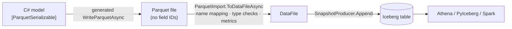

# Parquet.SourceGenerator as an Iceberg write path

[rtkelly-labs/Parquet.SourceGenerator](https://github.com/rtkelly-labs/Parquet.SourceGenerator) emits
zero-reflection, AOT-safe Parquet serializers for C# models at compile time, on top of Parquet.Net 6. For Iceberg
that is attractive: C# producers already have typed models, and a generated writer is faster and allocates less
than both reflection serializers and the row-of-objects path in `Iceberg.Net.Data`.

This page records **what was measured** (not assumed), what already works, and which gaps belong in the generator,
in Parquet.Net upstream, or in this library.

## How they fit together



The seam is **files, not assemblies**: iceberg-dotnet does not reference the generator. `ParquetImport` adopts any
Parquet file (generator, pyarrow, Spark) the way Java/PyIceberg `add_files` does — resolve columns through the
table's `schema.name-mapping.default`, verify every column has the Parquet representation Iceberg requires, compute
metrics and the partition tuple from the data — and rejects the file with a list of reasons otherwise.

Proven by `SourceGeneratorInteropTests` (published package 0.0.3): a generated file with `long`, `string?`,
`DateTime` (µs), `DateOnly`, `Guid`, `decimal(9,2)` and `int?` columns is adopted, reads back value-for-value in
.NET, **and PyIceberg reads it through the name mapping**.

## Measured behaviour

Inspected with pyarrow (physical/logical types, field IDs). "main" is the repository at `216f6fc`, built from source.

| C# member | 0.0.3 writes | main writes | Iceberg requires | Verdict |
|---|---|---|---|---|
| `long`, `int`, `bool`, `float`, `double` | INT64/INT32/… | same | same | ✅ |
| `string` | BYTE_ARRAY STRING | same | same | ✅ |
| `Guid` | FIXED(16) UUID, big-endian | same | FIXED(16) UUID, big-endian | ✅ |
| `decimal` + `[ParquetDecimal(9,2)]` | INT32 DECIMAL(9,2) | same | INT32 for P≤9, INT64 ≤18, FIXED otherwise | ✅ (P ≤ 28: `System.Decimal` limit) |
| `decimal` without attribute | DECIMAL(38,18) (from emitter source) | same | the table's declared (P,S) | ⚠️ must match the table; import checks |
| `DateTime` + `[ParquetTimestamp(Microseconds)]` | INT64 TIMESTAMP(µs, **UTC-adjusted**) | same | `timestamptz`: UTC-adjusted; `timestamp`: **not** | ⚠️ only `timestamptz` is expressible |
| `DateTime` (no attribute) | **INT96** | **INT96** | INT64 TIMESTAMP(µs) — writers must not emit INT96 | ❌ |
| `DateOnly` | INT32 DATE — but **0.0.3 cannot read it back** (`ArgumentException`) | **INT96** (round-trips in .NET; pyarrow reads a *datetime*) | INT32 DATE | ❌ on main; regression vs 0.0.3 |
| `TimeOnly` | — | INT64 TIME(µs, UTC-adjusted) | INT64 TIME(µs) (`isAdjustedToUTC=false`) | ✅ readable; ⚠️ annotation differs from Java's writer |
| `TimeSpan` | INT32 TIME(**ms**) | same | no Iceberg duration type; `time` is µs | ❌ |
| `uint`, `ulong`, `ushort` | unsigned INT annotations | same | no unsigned types | ❌ |
| field IDs | none | none | required for ID projection, or a name mapping | ⚠️ works via name mapping |
| nested `struct`/`List<T>` | — | supported (Parquet.Net trees) | field IDs on **group** nodes too | ❌ blocked upstream (below) |
| `timestamp_ns` (v3) | — | not offered (Parquet.Net has no nanos `DateTimeFormat`) | INT64 TIMESTAMP(ns) | ❌ blocked upstream |
| Column statistics | row-group min/max/nulls (Parquet.Net) | same | per-file metrics by field ID | ✅ computed by `ParquetImport` |

Every ❌/⚠️ row except the upstream ones is a characterization test in `SourceGeneratorInteropTests`
(`Gap_*`): the test asserts today's behaviour is rejected with a precise message, so closing a gap makes the test
fail and move into the compatible model.

## Where each gap should be fixed

| Gap | Fix in | Proposal | Effort |
|---|---|---|---|
| No field IDs | **generator** | `[ParquetFieldId(n)]` (or `[ParquetColumn(Id = n)]`) → set `DataField.FieldId` (settable in Parquet.Net 6.1; verified it reaches the file). Lets files skip name mapping and survive renames | S |
| `timestamp` vs `timestamptz` | **generator** | `[ParquetTimestamp(Microseconds, AdjustedToUtc = false)]` → `DateTimeDataField(..., isAdjustedToUTC: false)` (the constructor parameter exists in 6.1) | S |
| `DateOnly` → INT96 on main | **generator** (bug) | emit `DateTimeDataField(name, DateTimeFormat.Date)` → INT32 DATE (what 0.0.3 wrote), and fix 0.0.3's read path | S |
| `DateTime` default INT96 | **generator** | default to `DateAndTimeMicros`; INT96 is deprecated in Parquet and rejected by Iceberg | S (behaviour change → semver note) |
| `TimeSpan` as TIME(ms) | **generator** | an opt-in `Iceberg` profile that rejects `TimeSpan` (diagnostic) or maps it to `long` micros explicitly | S |
| Unsigned types | **generator** | same profile: diagnostic for unsigned members | XS |
| Iceberg schema from the model | **generator** | emit `public static string IcebergSchemaJson` (field IDs, required/optional, types) so `CreateTableAsync` can be driven by the model — no hand-written `Schema` | M |
| Per-file Iceberg metrics without a re-read | **generator** | expose written column stats (value/null/NaN counts, min/max) per file from the generated writer; `ParquetImport` currently re-reads the file to compute them | M |
| NDV sketches at write time (Puffin) | **generator** + this library | an optional per-column hook fed with Iceberg single-value bytes during write → `ThetaSketch.Update`; produces Puffin statistics with no second scan | M |
| Field IDs on nested groups | **Parquet.Net upstream** | lift `FieldId` to `Field` and emit/read it for struct/list/map — drafted issue + verified 19-line patch: [upstream/parquet-net-group-field-ids.md](upstream/parquet-net-group-field-ids.md) | S (upstream PR) |
| `timestamp_ns` | **Parquet.Net upstream** | a nanosecond `DateTimeFormat` / logical-type override for `DataField<long>` | S–M (upstream) |
| Decimal precision > 28 | generator + upstream | `System.Decimal` limit; would need a `BigInteger`-backed member type (Parquet.Net's plain encoder can't encode `BigInteger` today — generator rejects it with PARQ006) | M |

A suggested shape for the generator side is a single opt-in profile, so the default behaviour of the generator does
not change for non-Iceberg users:

```csharp
[ParquetSerializable(Profile = ParquetProfile.Iceberg)]   // diagnostics for INT96, TimeSpan, unsigned, missing IDs
public partial record Event
{
    [ParquetColumn("id", Id = 1)] public long Id { get; init; }
    [ParquetColumn("event_ts", Id = 2)]
    [ParquetTimestamp(ParquetTimestampUnit.Microseconds, AdjustedToUtc = true)] public DateTime EventTs { get; init; }
    [ParquetColumn("day", Id = 3)] public DateOnly Day { get; init; }          // INT32 DATE under the profile
}
// generated: Event.IcebergSchemaJson, writer returns per-column stats (+ optional theta sketch feed)
```

## What iceberg-dotnet did on its side

- `NameMapping` (spec "Column Projection"): build from schema, aliases for renames, JSON round-trip; the reader
  resolves ID-less files through it.
- `ParquetImport`: the type checker above, required/null checks, single-partition check, metrics.
- Decimal (INT32/INT64/FIXED read; ≤18 write) and UUID columns in `ParquetFiles` — the generator writes both
  correctly, which exposed that our reader could not read *required* UUID columns (fixed).

## Why not switch iceberg-dotnet to Parquet.Net + the generator entirely

The library's own writer (ParquetSharp) must handle *dynamic* schemas (any table, any evolution) and nested types
with group field IDs; a compile-time generator is for *static* models. They are complementary: the generator is the
fast typed path for producers with a known model; ParquetSharp stays the general engine. Revisit if Parquet.Net
gains group field IDs.
