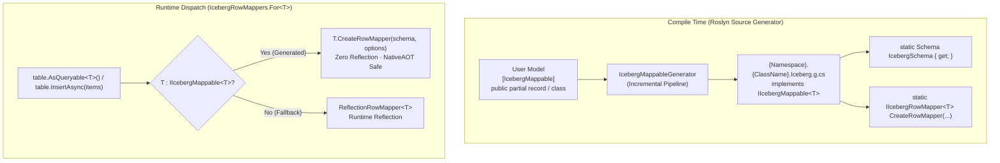

# Compile-Time Source Generation & TypeModel Optimization

This document details the architectural differences between `main` and the compile-time source generation branch (`rtkelly13/typemodel-sourcegenerator`), covering the tooling performance optimizations (PR #24) and the Roslyn incremental source generator for `Iceberg.Net.Linq` (PR #25). It also documents how the design incorporates architectural learnings and advances from [rtkelly-labs/Parquet.SourceGenerator](https://github.com/rtkelly-labs/Parquet.SourceGenerator).

---

## 1. Executive Summary

Historically, `Iceberg.Net.Linq` relied exclusively on runtime reflection to map user-defined C# classes and records to Iceberg schemas and physical table rows:
- Schema derivation traversed types using `Type.GetProperties()`, `NullabilityInfoContext`, and runtime attribute inspection.
- Row deserialization and serialization relied on `ReflectionRowMapper<T>`, which performed dynamic member binding, reflection invocation, and boxed dictionary lookups.
- Dynamic query compilation relied on runtime `Expression.Compile()`.

While flexible, this reflection-centric architecture carried significant drawbacks:
1. **Runtime Overhead & Allocations**: Boxing/unboxing of primitives, reflection method invocations, and dynamic property lookups during high-volume reads/writes.
2. **NativeAOT & Linker Trimming Hazards**: In modern .NET microservices and serverless/CLI runtimes (`PublishAot=true`), trimmer heuristics risk stripping untyped property accessors or generating `IL2026`/`IL2072` trim warnings.
3. **Late Error Detection**: Unsupported column types or schema mismatches were surfaced only when executing queries or writing batches at runtime.

The source generation pathway introduces `Iceberg.Net.SourceGenerator`, an incremental Roslyn generator (`IIncrementalGenerator`) that emits zero-reflection row mappers and compile-time `Schema` definitions for any model annotated with `[IcebergMappable]`.



---

## 2. Differences from `main` (Feature Matrix)

| Dimension | `main` (Runtime Reflection) | `typemodel-sourcegenerator` (Roslyn Source Generator) |
|---|---|---|
| **Mapping Strategy** | `ReflectionRowMapper<T>` evaluates model members at runtime via reflection | `IcebergMappableGenerator` emits zero-reflection `__GeneratedRowMapper` and `__GeneratedRowBinding` |
| **Schema Generation** | `IcebergSchema.FromType<T>()` inspects properties and attributes dynamically via reflection on every type initialization | Static compile-time `IIcebergMappable<T>.IcebergSchema` property emitted directly into the assembly |
| **Row Reader Dispatch** | Index/name lookup via `IcebergMemberBinding` and dynamic constructor invocation | Static property assignment with constructor parameter bindings and direct `row[i]` indexing |
| **Physical Conversions** | Dynamic unboxing and runtime conversions | Direct strongly-typed static conversions (`DateOnly.FromDayNumber`, `IcebergDecimal.ToDecimal`, microsecond epoch math) |
| **NativeAOT & Trimming** | Requires runtime reflection metadata preservation; prone to trimmer warnings | 100% NativeAOT safe, zero reflection, pure static C# code |
| **Diagnostics** | Runtime exceptions on unsupported types or unmapped required columns | Compile-time analyzer diagnostics (`ICERG001`, `ICERG002`, `ICERG003`) reported during IDE editing and build |
| **Fallback Strategy** | Reflection-only | Automatic dual-path dispatch: `IcebergRowMappers.For<T>()` resolves to compile-time mapper if `T : IIcebergMappable<T>`, otherwise falls back seamlessly to `ReflectionRowMapper<T>` |
| **Tooling & Fingerprints (PR #24)** | Whole-file memory buffering; standard SHA256 allocation | Streaming batch reads (`ReadBatchesAsync(1024)`) and stackalloc/rented span hashing via `SHA256.HashData` |
| **CLI Tools (PR #24)** | Standard JIT runtime for `tools/ShadowCompare` | `<PublishAot>true</PublishAot>` enabled for NativeAOT compilation and instant CLI execution |

---

## 3. Learnings from `Parquet.SourceGenerator`

The design of `Iceberg.Net.SourceGenerator` was informed by the patterns, benchmarks, and production experience of [rtkelly-labs/Parquet.SourceGenerator](https://github.com/rtkelly-labs/Parquet.SourceGenerator):

### A. Incremental Pipeline Hygiene & Caching
In Roslyn 4.0 incremental generators, retaining syntax nodes (`SyntaxNode`) or compilation-rooted symbols (`ISymbol`, `SemanticModel`) in pipeline state causes catastrophic memory retention and defeats incremental caching. `Parquet.SourceGenerator` pioneered strict decoupling:
1. **Syntax Filtering**: Light syntactic predicate checking for attributes before touching semantic models.
2. **Value-Equatable Extraction**: Transforming Roslyn symbols immediately into pure, immutable records containing only primitive types, strings, and value-equatable sequences.
3. **No Retained Symbols**: All downstream emitter stages consume only value models, ensuring Roslyn can cache transform outputs across typing keystrokes.

`Iceberg.Net.SourceGenerator` follows this exact discipline with `MappableTypeModel` and `MappablePropertyModel`.

### B. Property Kind Classification
Rather than performing repetitive string comparisons during code emission (e.g., `typeName == "System.DateTime"`), `Parquet.SourceGenerator` classifies properties at parse time into distinct kinds. In `IcebergMappableGenerator`, member types are resolved into strongly typed Iceberg representations:
- Primitives (`long`, `int`, `bool`, `float`, `double`, `string`, `Guid`)
- Decimals (`decimal` with optional precision/scale annotations)
- Temporal types (`DateOnly`, `TimeOnly`, `DateTime`, `DateTimeOffset`, `TimeSpan`)
- Enums (mapped to underlying numeric types or string representation)
- Binary / Fixed byte arrays (`byte[]`)

### C. Deterministic Field ID Allocation
In Iceberg tables, columns are resolved by immutable 32-bit field IDs, not by name or ordinal position. When generating schemas from models:
- Explicit field IDs declared via `[IcebergField(id)]` must be reserved first.
- Auto-assigned properties must select the lowest free non-colliding IDs (`1, 2, 3, ...`) skipping any explicitly reserved IDs.
This prevents ID collisions between explicit and implicit column assignments.

### D. CS8785 Collision Avoidance via Namespace-Qualified Hint Names
`SourceProductionContext.AddSource` requires generated hint names to be globally unique within a generator. If two models share a class name in different namespaces (e.g. `Sales.Order` and `Billing.Order`), using `{ClassName}.g.cs` causes generator crash CS8785. `IcebergMappableGenerator` qualifies hint names as `{Namespace}.{ClassName}.Iceberg.g.cs`.

### E. Natural Ternary Typing for Nullable Conversions
When emitting conditional conversions for nullable types:
```csharp
// Problematic: C# infers ternary return type from the true branch, returning default(DateOnly)
// rather than (DateOnly?)null:
v is int days ? DateOnly.FromDayNumber(days) : default

// Correct: explicit type cast ensures ternary evaluates to DateOnly?
v is int days ? DateOnly.FromDayNumber(days) : default(DateOnly?)
```
`IcebergMappableGenerator` emits `default({p.TypeDisplay})`, ensuring nullable value types evaluate to `null` instead of their default non-null zero representation.

---

## 4. Key Differences in Detail

### 1. Dual-Path Static Dispatch (`IIcebergMappable<T>`)
The LINQ layer introduces a zero-cost abstraction using C# 11 static abstract interface members:

```csharp
public interface IIcebergMappable<T> where T : IIcebergMappable<T>
{
    static abstract Schema IcebergSchema { get; }
    static abstract IIcebergRowMapper<T> CreateRowMapper(
        Schema schema,
        RowMappingOptions? options = null,
        NameMapping? nameMapping = null);
}
```

Consumers use `IcebergRowMappers.For<T>()`:
```csharp
public static class IcebergRowMappers
{
    public static IIcebergRowMapper<T> For<T>(
        Schema schema,
        RowMappingOptions? options = null,
        NameMapping? nameMapping = null)
    {
        // 1. Compile-time generated path
        if (typeof(IIcebergMappable<T>).IsAssignableFrom(typeof(T)))
        {
            return StaticMapperInvoker<T>.CreateRowMapper(schema, options, nameMapping);
        }

        // 2. Reflection fallback path
        return new ReflectionRowMapper<T>(schema, options, nameMapping);
    }
}
```
This design is 100% backward compatible: unannotated models continue using `ReflectionRowMapper<T>`, while models marked with `[IcebergMappable]` instantly unlock zero-reflection execution without changes to caller code.

### 2. Schema-Based Member Resolution
At bind time (`CreateRowMapper`), the generated mapper resolves model properties against the target Iceberg `Schema` in compliance with the Iceberg spec:
1. **Explicit Field ID**: Matches `[IcebergField(id)]`.
2. **Options Overrides**: Matches field ID mappings supplied in `RowMappingOptions.FieldIds`.
3. **Name Mapping**: Resolves external column names and aliases defined in `NameMapping.Fields`.
4. **Column Name / Converter**: Matches explicit `[IcebergColumn("name")]`, or property names transformed through `options.NameConverter` (e.g. `IcebergNaming.SnakeCase`).
5. **Case-Insensitive Match**: If enabled via `options.CaseInsensitive = true`.

Unmapped properties are tracked safely: if a column is absent from an older snapshot or projected out of a scan, value types retain their default values while nullable types remain `null`.

### 3. Object Construction & Property Mutation
`ReflectionRowMapper<T>` dynamically compiles constructors and delegates at runtime. In contrast, `IcebergMappableGenerator` emits concrete factory code:
- **Constructor Matching**: Selects the constructor whose parameter names best match the model's mapped properties (ideal for positional records).
- **Property Initialization**: Assigns remaining properties via `init` or `set` accessors directly in C#.
- **No Activator.CreateInstance**: Completely bypasses reflection instantiation.

### 4. Compile-Time Diagnostics

Rather than failing at runtime when executing a query or reading a Parquet file, the generator emits compile-time diagnostics:

| ID | Severity | Description |
|---|---|---|
| `ICERG001` | Error | Property has an unsupported type for Iceberg mapping. |
| `ICERG002` | Error | Property is marked as an identifier key but has an unsupported key type. |
| `ICERG003` | Warning / Info | Nested complex types or generic structures are not yet supported for zero-reflection mapping and will fall back to reflection. |

---

## 5. Tooling Performance Enhancements (PR #24)

Prior to the source generator, PR #24 introduced foundational runtime performance improvements:

1. **Streaming Fingerprint Batches (`TableFingerprint.cs`)**:
   - Replaced unbounded `DataFiles.ReadAllAsync()` accumulation with batched streaming (`ReadBatchesAsync(1024)`).
   - Replaced per-file byte allocations with stack-allocated buffers and rented arrays (`ArrayPool<byte>.Shared.Rent`).
   - Employed `SHA256.HashData(ReadOnlySpan<byte>, Span<byte>)` for zero-allocation cryptographic hashing.
2. **NativeAOT for Tooling (`ShadowCompare`)**:
   - Enabled `<PublishAot>true</PublishAot>` in `tools/ShadowCompare/ShadowCompare.csproj`.
   - Stripped reflection dependencies, enabling single-binary compilation with sub-millisecond startup times for shadow-comparison runs.
3. **Reflection Accessor Caching**:
   - Cached `KeyValuePair` reflection getters in `ReflectionRowMapper.cs`.
   - Compiled parameterless constructors in `TypeModel.cs` for list/map factories.
   - Cached generic methods and avoided runtime `Expression.Compile()` in `IcebergQueryCompiler.cs`.

---

## 6. How `Iceberg.Net` Differs from `Parquet.SourceGenerator`

While `Iceberg.Net.SourceGenerator` borrows architectural principles from `Parquet.SourceGenerator`, the underlying execution models serve different abstractions:

| Feature | `Parquet.SourceGenerator` | `Iceberg.Net.SourceGenerator` |
|---|---|---|
| **Output Target** | Columnar arrays transposed into low-level Parquet row-group streams | Row-based object mapping for Iceberg table readers and LINQ queries |
| **Schema Representation** | Parquet schema tree (`DataField`, `StructField`, `ListField`, `MapField`) | Iceberg spec schema (`Types.NestedField`, `Schema`, `IcebergDecimal`, field IDs) |
| **Column Resolution** | Column order or names in file schema | Spec-mandated 32-bit Field IDs and partition spec alignment |
| **Schema Evolution** | Re-reads entire file with target schema | Dynamic column projection across snapshots using field IDs |
| **Timestamp Units** | Microseconds and Nanoseconds (with `isAdjustedToUTC` flag) | Microsecond epoch timestamp with and without timezone (`timestamptz` / `timestamp`) |

---

## 7. Future Roadmap

1. **Compound Types (Structs, Lists, Maps)**:
   - Adopt `Parquet.SourceGenerator`'s compound parsing models (`Children`, `Element`, `MapValue`) to emit zero-reflection row bindings for nested Iceberg structs, lists, and maps.
2. **Shared EquatableArray<T> Primitive**:
   - Extract the `EquatableArray<T>` pattern as models grow in complexity to guarantee Roslyn cache invariance across larger AST structures.
3. **Direct Parquet-to-Row Bridge**:
   - Enable direct ingestion pipelines where `Parquet.SourceGenerator` output can be bound directly to Iceberg `DataFile` manifests without intermediate row boxing.
