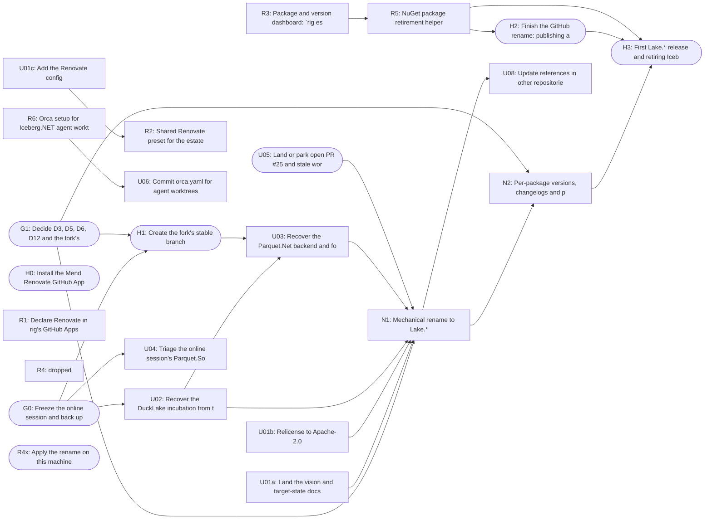

# Lake.NET: rename and estate tooling, execution plan

**Status:** plan, not started (written 2026-10-28). Local and gitignored; the durable copy is the GitHub issues
generated from `units.json` (see the end). The target state it executes is in `docs/lake/` (in the
`/Users/ryankelly/orca/workspaces/Iceberg.NET/anthias` worktree until U01a merges).

## Scope

The **repository rename** (Iceberg.NET → Lake.NET, `Iceberg.Net.*` → `Lake.*`) and the **rig tooling** to manage it
and the estate (Renovate governance, a package dashboard, repository rename support, package retirement, Orca
setup). It first **recovers** the online Claude session's work (`ccr-87fadcf9-bxi9wr`, in three repositories), because the
rename can't start while that branch is open.

Out of scope here (each has its own plan in the docs):

- Extracting Lake.Core / Lake.Data (phase 3): `docs/lake/shared-layers.md#phase-3-extraction`
- Parquet.Net fork tier 2 rewrite (D10): `docs/lake/decisions.md#d10`
- ORC port (D8): `docs/lake/decisions.md#d8`
- Delta Lake (phase 4): `docs/lake/delta.md`
- Verification tracks (coverage, pathways, chaos, benchmarks): `docs/lake/verification/README.md`
- Maven jars through Renovate: `docs/dependencies.md#planned-maven-jars-through-renovate`

## Facts the plan relies on (checked 2026-10-28)

- `ccr-87fadcf9-bxi9wr` in Iceberg.NET: 50 commits on top of #23, head `4eeff8a`, CI green at the head. It splits cleanly at
  `ef5eb9d`: before it, DuckLake only (37 commits, `1366c52` through `ef5eb9d`; `.gitmodules`, `external/` and `Iceberg.Net.Data.ParquetNet` do not exist
  yet; CI green at `7c03913`, the last code commit); after it, the Parquet.Net backend and fork submodule (13 commits).
  11 intermediate commits failed CI; the PRs' own CI decides, not the history.
- The same session pushed `ccr-87fadcf9-bxi9wr` to rtkelly-labs/parquet-dotnet (head `380ba10`) and to Parquet.SourceGenerator (head `5ed2b69`).
- The GitHub repository was renamed to `rtkelly-labs/Lake.NET` on 2026-10-28, ahead of N1. GitHub redirects the old
  URLs and git remotes; the local clone, Orca's display name (`Iceberg.NET`) and folder names are unchanged until R4x.
- `main` is at `c599bc9` (#24 merged). PRs #25 (`rtkelly13/typemodel-sourcegenerator`) and #26
  (`fix/full-stack-readiness`, 79 files) are open.
- In rig, open work overlaps R4 (PR #330 org folder layout, PR #348 a previous repo rename), R5 (branch
  `docs/nuget-new-package-runbook`) and R6 (PR #320 Orca sessions). The briefs say how to handle each.
- rig already has: `config/managed-projects.json` with every package (registry, name, manifest, workflow, `auth: oidc`),
  `config/repo_policies.json` `github_apps` with audit/enforce, `estate` (audit, sync, tidy, decisions, orca), and
  `workspace orca doctor|sync`.
- Orca: agents `codex` and `antigravity`; `orca worktree create --repo … --base-branch … --agent … --prompt …` makes the
  isolated checkout and starts the agent in one step. Iceberg.NET's Orca worktrees currently land under
  `~/orca/workspaces/Iceberg.NET/`; R6/U06 move new ones under the repo's `temp/`, like the other repos.

## How isolation works

1. **One unit, one worktree, one branch, one PR.** Orca creates the worktree from the unit's base ref; the agent works
   only there. Briefs are self-contained: an agent needs nothing from this conversation.
2. **Dependencies are merges.** A unit starts only when each dependency is merged (agent units) or done (human
   units). Waves are a guide; the DAG is the rule.
3. **Locks** (things that can't run twice at once on this machine):
   - **Emulation stack:** moto :5000, REST :8181, Trino :8080, Polaris and the rest share fixed ports. Only one worktree
     may run `./run-tests.sh emulation` or the Docker suites at a time; otherwise rely on PR CI.
   - **Stryker** needs exclusive use of the build output; not used by these units.
   - **Repository lock for N1:** while the rename PR is open, nothing else merges into Iceberg.NET. N2 is stacked on
     it and merges straight after.
4. **Shared files serialise.** `AGENTS.md`, `CHANGELOG.md`, `docs/README.md`, `src/Directory.Build.props` are touched by
   U01a/b/c, U02, U03 and N1. Merge order: U01a → U01b → U01c → U02 → U03 → N1; each later one rebases.
5. **Human gates** (rounded boxes below) are things only you can do: stop the online session, decisions, GitHub and
   nuget.org settings, installing apps, releasing.

## Dependency graph



## Units

| Unit | Wave | Executor | Repository | Depends on | Status (checked 2026-10-29 ~23:20) |
|---|---|---|---|---|---|
| [G0](units/G0.md) Freeze the online session and back up its branches | 0 | human | (all) | — | partial: backup tags done; stop the online session |
| [G1](units/G1.md) Decide D3, D5, D6, D12 and the fork's stable branch | 0 | human | Iceberg.NET | — | todo |
| [U01a](units/U01a.md) Land the vision and target-state docs | 1 | claude (this session) or agent | Iceberg.NET | — | PR Lake.NET#46 green; blocked by ~18 unresolved CodeRabbit threads |
| [U01b](units/U01b.md) Relicense to Apache-2.0 | 1 | claude (this session) or agent | Iceberg.NET | — | PR Lake.NET#47 green, ready |
| [U01c](units/U01c.md) Add the Renovate config | 1 | claude (this session) or agent | Iceberg.NET | — | merged as Lake.NET#50 (38a1604) |
| [H0](units/H0.md) Install the Mend Renovate GitHub App | 1 | human | (org) | — | partial: installed on rtkelly13 (rig#397 onboarding PR); no Renovate activity on rtkelly-labs yet |
| [U02](units/U02.md) Recover the DuckLake incubation from the online session | 1 | antigravity | Iceberg.NET | G0 | split into a stack: #51–#56 (1–6/7) + #49 (7/7); #54, #55 fail cross-engine (DuckDB `->` lambda, fixed in a later layer) |
| [U05](units/U05.md) Land or park open PR #25 and stale worktrees | 1 | human | Iceberg.NET | — | waiting on you: #25, #26, new #48 |
| [R1](units/R1.md) Declare Renovate in rig's GitHub Apps governance | 1 | antigravity | rig | — | PR rig#392 now conflicts with rig main (#411 simplification stack); worktree closed |
| [R2](units/R2.md) Shared Renovate preset for the estate | 1 | antigravity | rtkelly-labs/.github | U01c | unblocked (#50 merged); launch held until you confirm |
| [R3](units/R3.md) Package and version dashboard: `rig estate packages` | 1 | antigravity | rig | — | PR rig#393 now conflicts with rig main (#411 simplification stack); worktree closed |
| [R4](units/R4.md) Repository rename support: `rig estate rename-repo` | 1 | antigravity | rig | — | dropped 2026-10-28: you don't want a rename tool in rig; close rig#394 |
| [R5](units/R5.md) NuGet package retirement helper | 1 | antigravity | rig | R3 | todo |
| [R6](units/R6.md) Orca setup for Iceberg.NET agent worktrees | 1 | antigravity | rig | — | PR rig#391 behind main, mergeable; worktree closed |
| [U06](units/U06.md) Commit orca.yaml for agent worktrees | 1 | antigravity | Iceberg.NET | R6 | todo |
| [H1](units/H1.md) Create the fork's stable branch | 2 | human | parquet-dotnet | G0, G1 | todo |
| [U03](units/U03.md) Recover the Parquet.Net backend and fork submodule | 2 | antigravity | Iceberg.NET | U02, H1 | todo |
| [U04](units/U04.md) Triage the online session's Parquet.SourceGenerator branch | 2 | antigravity | Parquet.SourceGenerator | G0 | SG#741 closed by you 2026-10-29; worktree sg-ccr-triage still open |
| [N1](units/N1.md) Mechanical rename to Lake.* | 3 | antigravity | Iceberg.NET | G1, U01a, U01b, U02, U03, U05 | todo |
| [N2](units/N2.md) Per-package versions, changelogs and public API files | 3 | antigravity | Iceberg.NET | N1, G1 | todo |
| [H2](units/H2.md) Finish the GitHub rename: publishing and app checks | 4 | human | Iceberg.NET | R5 | todo |
| [R4x](units/R4x.md) Apply the rename on this machine | 4 | human | rig | — | todo: rename by hand or with the CLI; rig's existing checks pick it up |
| [U08](units/U08.md) Update references in other repositories | 4 | antigravity | (estate) | N1 | todo |
| [H3](units/H3.md) First Lake.* release and retiring Iceberg.Net.* | 5 | human | Lake.NET | N2, H2, R5 | todo |

Launch commands for every agent unit are in [launch.md](launch.md).

## Turning units into GitHub issues

Not run yet; it creates public issues, so confirm first. Repository per unit is in `units.json`:

```bash
python3 - <<'EOF'
import json, subprocess
for u in json.load(open('/Users/ryankelly/orca/workspaces/Iceberg.NET/anthias/temp/lake-plan/units.json')):
    repo = {'Iceberg.NET': 'rtkelly-labs/Lake.NET', 'rig': 'rtkelly13/rig',
            'Parquet.SourceGenerator': 'rtkelly-labs/Parquet.SourceGenerator'}.get(u['repo'])
    if not repo: continue
    subprocess.run(['gh', 'issue', 'create', '--repo', repo, '--title', f"[lake-plan {u['id']}] {u['title']}",
                    '--body-file', f"/Users/ryankelly/orca/workspaces/Iceberg.NET/anthias/temp/lake-plan/units/{u['id']}.md", '--label', 'lake-plan'], check=True)
EOF
```

Then pass `--issue <number>` to `orca worktree create` so each worktree links its issue.
